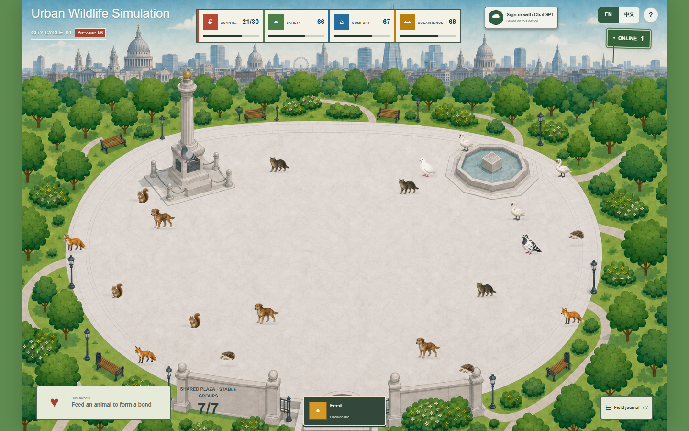
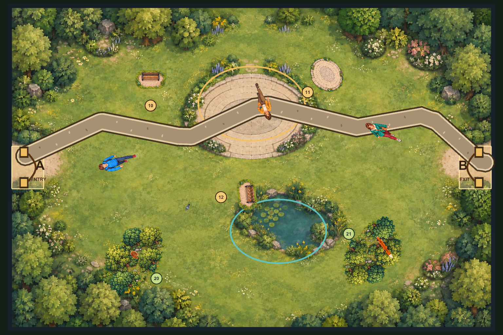
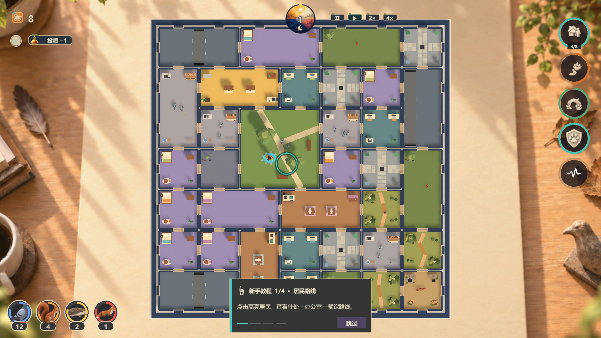
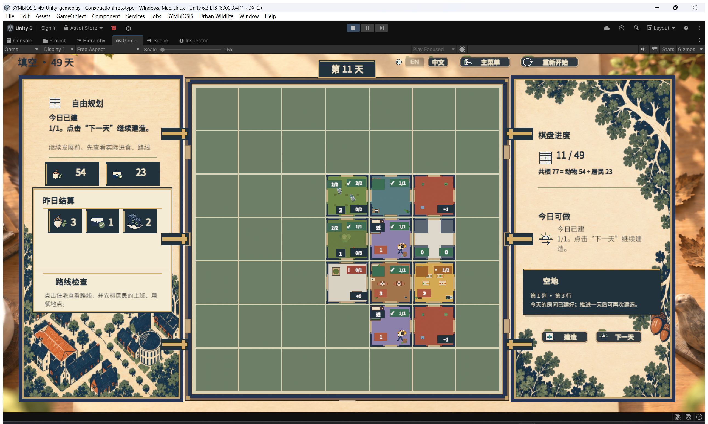
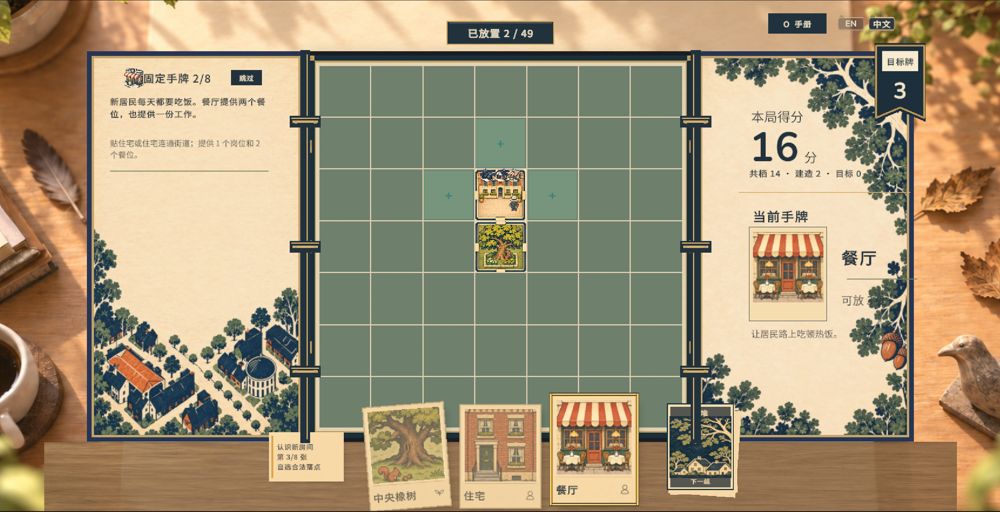
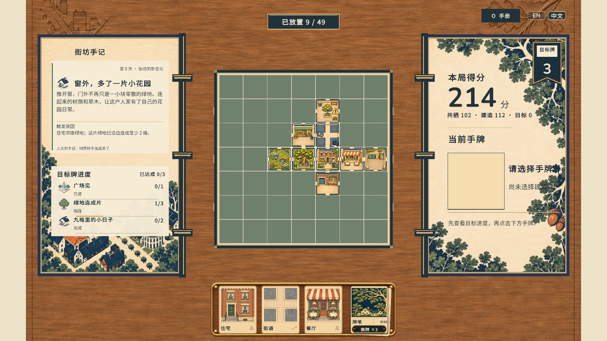
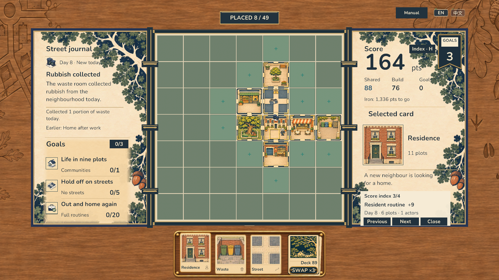
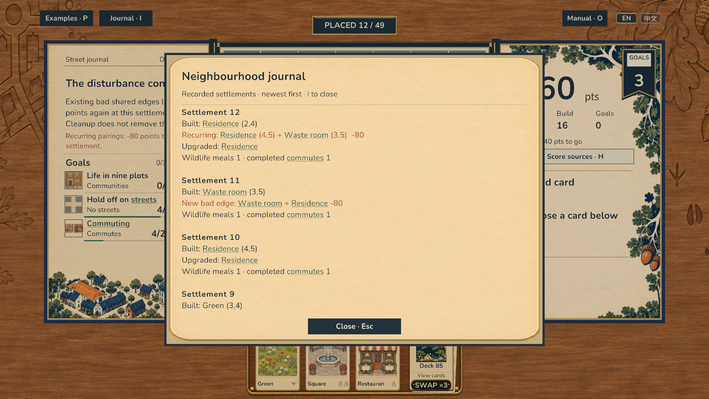
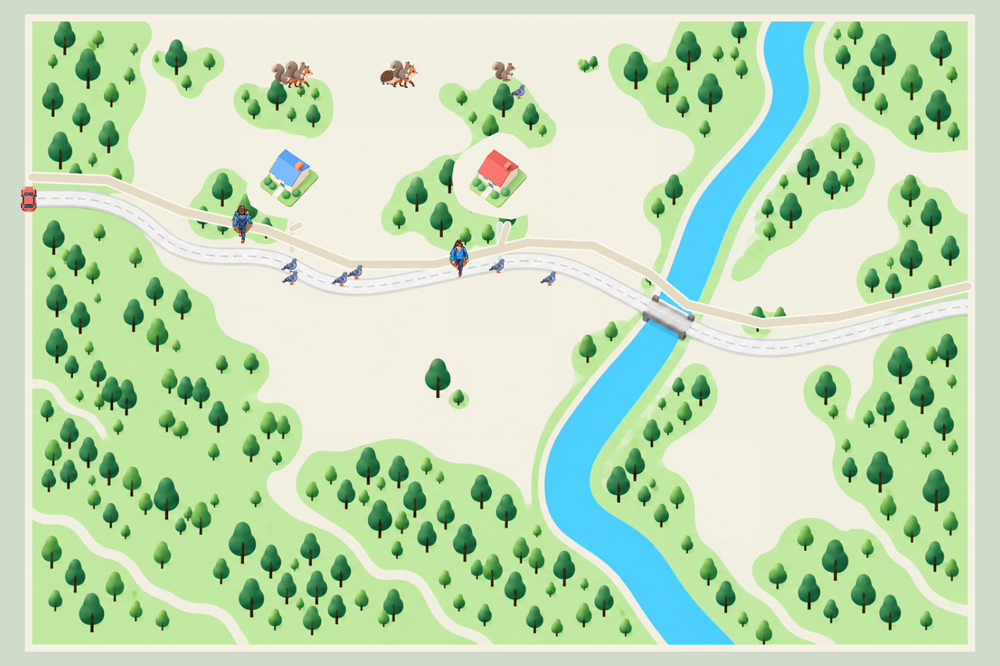

# Development journal

This retrospective account was assembled from commits, saved designs, software reports and captures.
Dates refer to those records, not automatically to participant sessions.
The [design decisions](DESIGN_DECISIONS.md) explain the reasons behind the main changes.

## Timeline

| When | Stage | Preview | Read |
| --- | --- | --- | --- |
| July-August 2026 | Browser feeding prototype |  | [01](#01-browser-prototype) |
| September | Physical input and city planning |  | [02](#02-physical-input-and-city-planning) |
| 22 September-6 October | Room rearrangement and Research configurations |  | [03](#03-room-board) |
| October | Progressive construction |  | [04](#04-progressive-construction) |
| November; exact session dates partly undocumented | Cards, upgrades and playtesting |  | [05](#05-cards-upgrades-and-playtesting) |
| 19 November source snapshot | Scoring, goals, stories and result review |  | [06](#06-scoring-and-reliability) |
| 20-21 November | Archive, reading and score-source review |  | [07](#07-archive-and-interface-review) |
| 22 November | Final source, version archive and ethics account |  | [08](#08-final-source-and-project-record) |

Click a preview to open the image. Each stage below includes a larger view and a caption. Historical captures and later rerenders are labelled.

## 01 Browser prototype

*Archived browser prototype showing the feeding action. Capture date unrecorded.*

The project began with feeding animals at a church. The first digital prototype used virtual pigeons. Players later chose where to throw food and watched nearby animals respond.
This introduced spatial choices without directly controlling each animal.

The first recorded browser build is [22 July](https://github.com/Ketian-LI/urban-wildlife-simulation/commit/8eed0a56abad62e360fa46ff50e127a606d5f6ab).
The [web development account](https://github.com/Ketian-LI/urban-wildlife-simulation/blob/main/docs/WEB_DEMO_DEVELOPMENT.md)
and [commit table](../Misc/process/history/early-web-history.csv) record that stage.
The [web version page](../Project/00-Web-Prototype/README.md) links the hosted prototype and archived source.

## 02 Physical input and city planning

*Archived park-planning image from the development presentation. Feeding areas and a main route make spatial choices visible; the capture date is unrecorded.*

The Unity work moved through park planning and an open woodland city, then explored building tokens, camera input, placement previews and city routes.
More decisions also brought more rules and input failures to diagnose. Physical recognition remained a separate,
partly verified prototype; the records do not establish reliable physical play or a completed camera-based study.
The date and build of the earliest Unity transfer remain partly documented.

*Open-city version, rerendered on 11 November from September source commit `80d8bab`. This is a later render of the historical project, not a September screenshot.*

Read the [migration record](https://github.com/Ketian-LI/urban-wildlife-tangible-unity/blob/main/docs/GDD_V3_MIGRATION.md),
[source package](../Project/01-Tangible-Unity/README.md) and
[retained camera guide](../Project/04-Final/Tools/CameraRecognition/README.md).

## 03 Room board

*Earlier full-board capture from the September project records. Rooms surround a fixed central green area; players rearrange an existing layout.*

The [22 September import](https://github.com/Ketian-LI/symbiosis-49-unity/commit/aeca20ab64a41fbfdc36031663db6c1d94acd5c1)
introduced the recorded room project. A bounded board made routes and neighbour relationships easier to compare.
This stage used room rearrangement, onboarding and Research configurations.

The [6 October source](../Project/02-Room-Board-Unity/README.md),
[Unity history](../Misc/process/history/symbiosis-unity-history.csv) and
[historical designs](../Misc/archive/legacy-docs) retain the earlier rules.

## 04 Progressive construction

*Unity Editor capture from the late-October records, with the source file dated 29 October. The partial layout shows construction before the later card-hand presentation.*

The [9 October prototype](https://github.com/Ketian-LI/symbiosis-49-unity/commit/7a3691212c01596eb32e4325724be75aecd932cf)
changed the task from rearranging a populated board to building it one placement at a time.
The [10 October menu entry](https://github.com/Ketian-LI/symbiosis-49-unity/commit/734b5b7e6e15236ab6684783ed05540b8e3e112a)
connected construction to the opening and return flow. Later work added category limits and construction-box presentation.

This made the opening a teaching problem: players needed to learn each room before choosing among many types.
The [20 October source](../Project/03-Progressive-Construction/README.md) records this stage.

## 05 Cards upgrades and playtesting

*Archived November-stage opening shown in the supplied presentation. The oak and home are built; the restaurant card introduces food. The exact capture date is unrecorded.*

November work developed illustrated cards, a lower hand tray, visible upgrades and a staged opening.
Visual review identified small text, detached hinges, wasted space and panels covering useful information.
These comments guided revisions; they were not a controlled comparison of visual styles.

Two rounds of remote playtesting raised questions about unclear rules, delayed consequences and repetition.
The [evaluation](EVALUATION.md#playtesting) records the participants, method and limits.
Rules changed between rounds, so the final rules cannot be applied backwards to every session.

## 06 Scoring and reliability

*Fixed-layout render of the 19 November source: a garden-home story gives its trigger beside the goals and illustrated board.*

The 19 November snapshot brought together stronger layout effects, visible deductions, result review and neighbourhood stories.

| Problem | Revision | Supporting record |
| --- | --- | --- |
| Good and poor layouts ended with similar scores | V13 increased the effect of favourable and unfavourable pairings | [Scoring checks](../Misc/evidence/automated-tests/scoring-and-storage.xml) |
| Name entry and restart controls could be blocked | Input focus and overlapping pointer targets were repaired | [Result checks](../Misc/evidence/automated-tests/result-interactions.xml) |
| Goals disappeared after restart or tutorial skip | Goal presentation was reset for each run | [Failure](../Misc/evidence/automated-tests/goal-restart-before-fix.xml) and [repair](../Misc/evidence/automated-tests/goal-restart.xml) |
| The left page had little to explain | Stories followed placements and recorded activity | [Story checks](../Misc/evidence/automated-tests/story-model.xml) |

The [Windows release](https://github.com/Ketian-LI/symbiosis-49-unity/releases/tag/archive-2026-11-20)
was published on 20 November from the 19 November build.

## 07 Archive and interface review

*21 November Unity fixture. The score-source entry retains a routine, affected plots and navigation after settlement.*

The English archive brought source, history, selected checks and screenshots together on 20 November.
It was a published project archive, not a Moodle submission.
The next review checked bilingual text and compared diagnostic placement policies.

The [reading and balance review](../Misc/process/iterations/SKILL_GUIDED_UI_2026-11-21.md),
[score-source record](../Misc/process/iterations/SCORE_INDEX_2026-11-21.md),
[left-page record](../Misc/process/iterations/LEFT_LEAF_STYLE_2026-11-21.md) and
[goal UI record](../Misc/process/iterations/GOAL_PROGRESS_UI_2026-11-21.md) retain the dated detail.
Score causes became available after the animation, while the goal display separated names, metrics and progress.
Some opening checks still failed, as recorded in [evaluation](EVALUATION.md#software-checks).

## 08 Final source and project record

*22 November commuting/reference fixture. The separate journal records settled placements, upgrades and recurring deductions.*

The final interface brought together illustrated cards, the real deck catalogue and persistent room relationships.
The next completed source revision added automatic commuting, linked manual terms, recurring Fill deductions,
three P-key example pages and an independent I-key journal. Zero-value road warnings and duplicate exposure markers were corrected.
The [implementation record](../Misc/process/iterations/COMMUTING_REFERENCE_AND_PENALTIES_2026-11-22.md) links the source and saved checks.

The [Project index](../Project/README.md) identifies the current final snapshot and historical downloads.
The updated dissertation supplies the thirteen-record questionnaire account and one separate follow-up observation;
the earlier presentation retains its nine-form snapshot. [Evaluation](EVALUATION.md) keeps those records distinct.

All participant consent forms and the project plan have now been sent to the supervisor. They have not yet been reviewed.
The [ethics reflection](ETHICS_REFLECTION.md) retains the earlier oversight and outstanding data-handling issues.
The [submission record](assessment/README.md) identifies included material and omissions.

[Back to timeline](#timeline)
