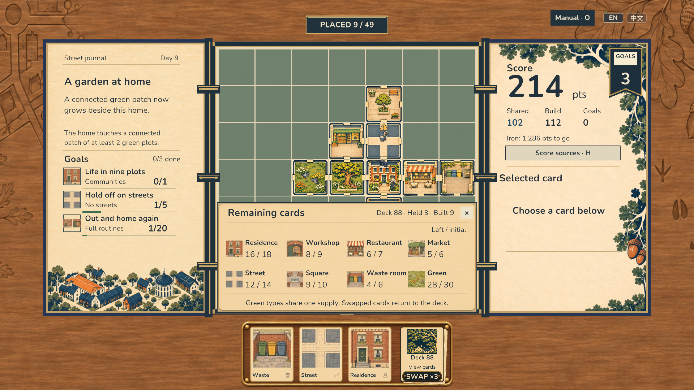
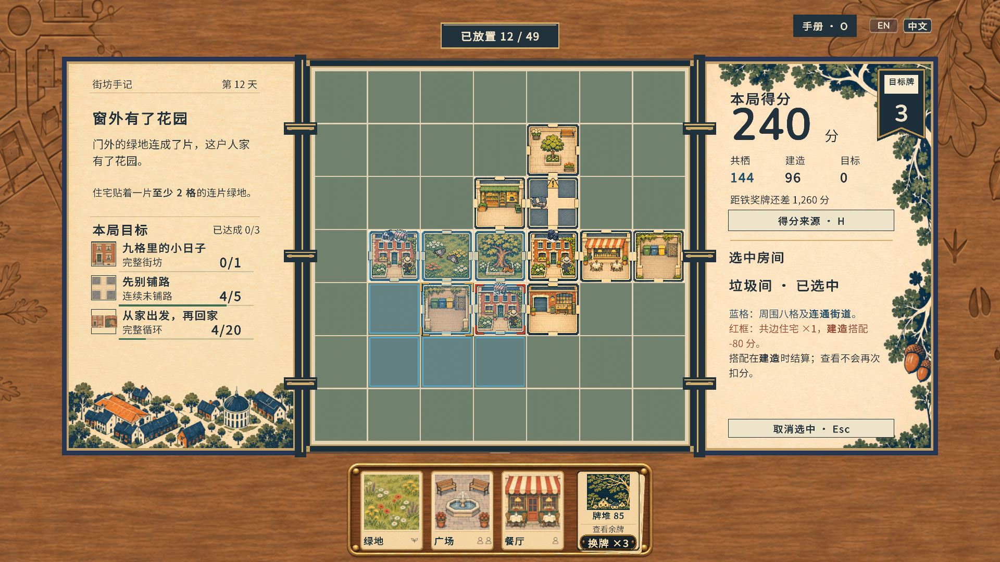

# Portfolio

SYMBIOSIS: 49 turns a sequence of small placements into a shared neighbourhood. The player builds homes, services and
habitat, then watches residents and animals use the space. The [final Unity version](../Project/04-Final/README.md)
is separate from its [earlier prototypes](../Project/README.md).

## The board and hand

The hand sits below the board. The left page brings stories and goals together; the right page groups the score,
score-source entry and selected card. Guidance emphasizes the action without making the whole paragraph bold.

## Inspect the remaining cards

Clicking the draw pile opens the real remaining-card catalogue. Counts distinguish the pile, held cards and built rooms.
The catalogue stays over the lower board and leaves both information pages readable.

## Distinguish coverage from a penalty

A selected waste room can show blue collection coverage and red shared-edge pairing warnings at the same time.
The two effects remain distinct: a home can be covered without receiving that particular pairing penalty.

## Follow the score

Resident, animal and shared-score phases highlight their own contributors. The previous batch clears before the next.
The score-source review keeps the latest settlement available after the animation.

These images are actual Unity renders of fixed test layouts from the 22 November source revision.
They document software appearance rather than participant sessions. [Screenshot records](media/screenshots/README.md)
identify the earlier captures; [demonstration coverage](media/demonstrations/README.md) is listed separately.

## Where it began

The [web prototype](../Project/00-Web-Prototype/README.md) explored feeding and animal responses.
The [development journal](DEVELOPMENT_JOURNAL.md) connects that work to physical input, room construction and the final hand.
The [report](PROJECT_REPORT.md) explains the design account, and [evaluation](EVALUATION.md) states the evidence limits.
