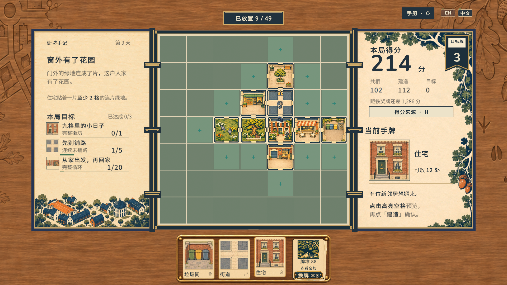
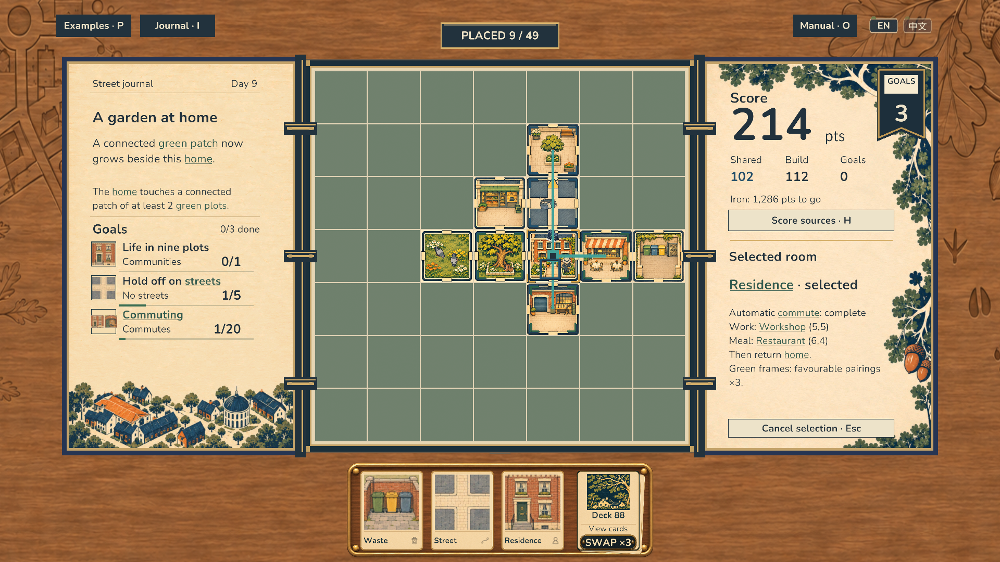
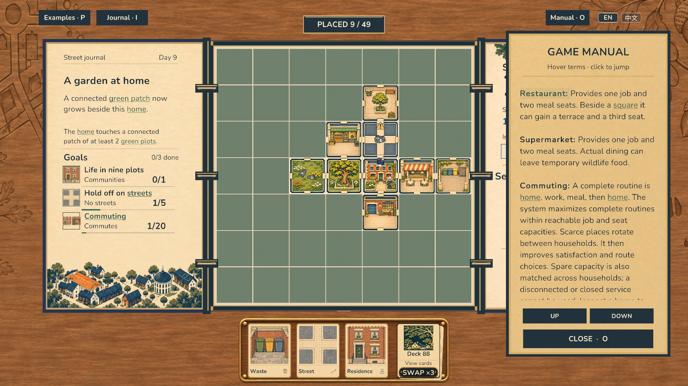
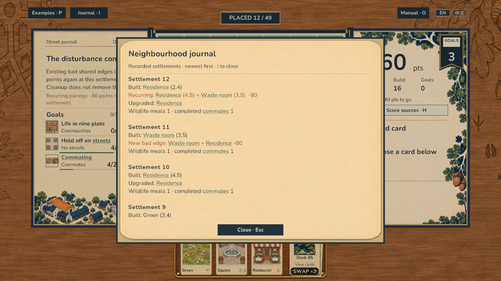
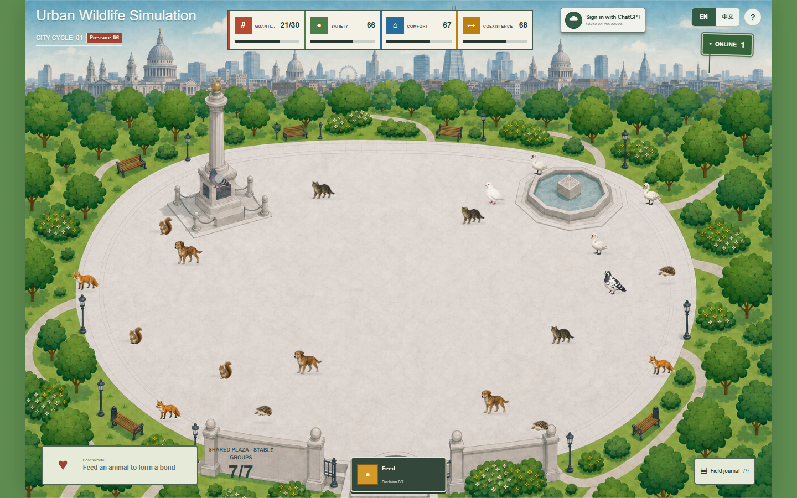

# Portfolio

SYMBIOSIS: 49 turns successive placements into a neighbourhood used by residents and animals.
The [final source](../Project/04-Final/README.md) and [earlier prototypes](../Project/README.md) are recorded separately.

## Board and hand

Cards sit in a compact tray. The left page groups goals and neighbourhood stories; the right page shows score and selected-room information.
The real [deck catalogue](media/screenshots/fill-deck-en.png) distinguishes cards in the pile, held cards and built rooms.

## Automatic commuting

Selecting a home shows its work and meal destinations and missing links. The layout still determines access and capacity.

## Explanations in context

Hovering a linked term shows its meaning. Clicking opens the actual manual heading.
The [building examples](media/screenshots/building-example-1-en.png) explain commuting and edge-connected routes.

## Persistent consequences

The journal retains recorded deductions, placements and upgrades. Existing bad edges can appear again at later Fill settlements.
Coverage and housing disturbance remain distinct; the [reference diagrams](media/screenshots/building-example-2-en.png) compare them.

## Development context

The [journal](DEVELOPMENT_JOURNAL.md#timeline) follows feeding, park planning, an open city, room rearrangement and construction.
Unity images above are fixed test renders, not participant sessions. The [screenshot index](media/screenshots/README.md)
identifies their source groups. [Evaluation](EVALUATION.md) states what the participant and software evidence supports.
