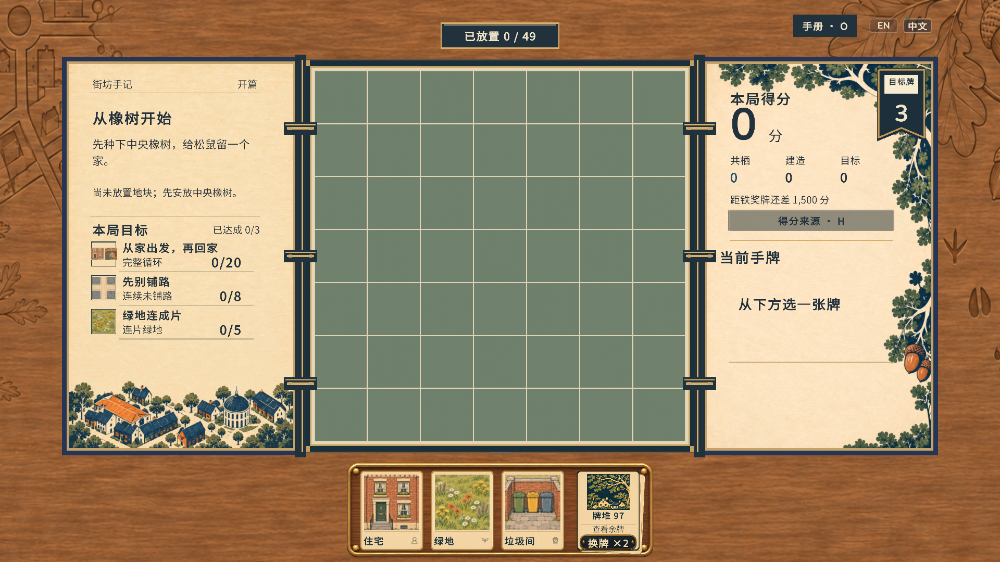
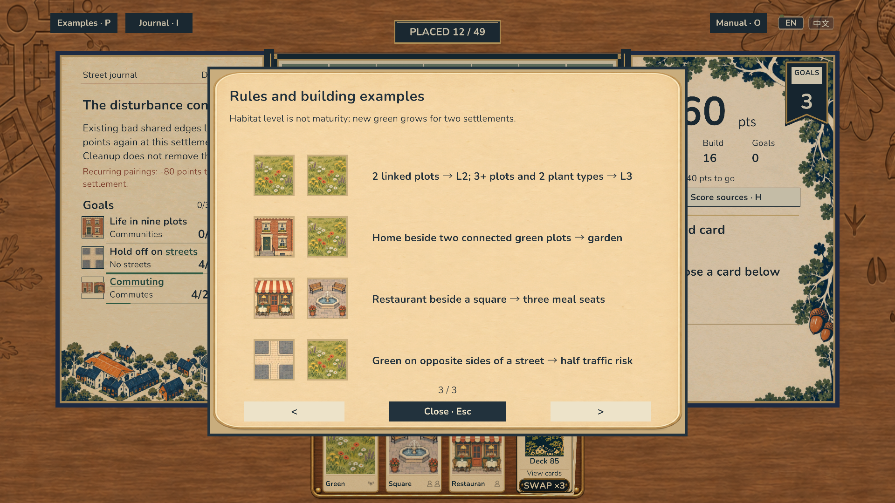
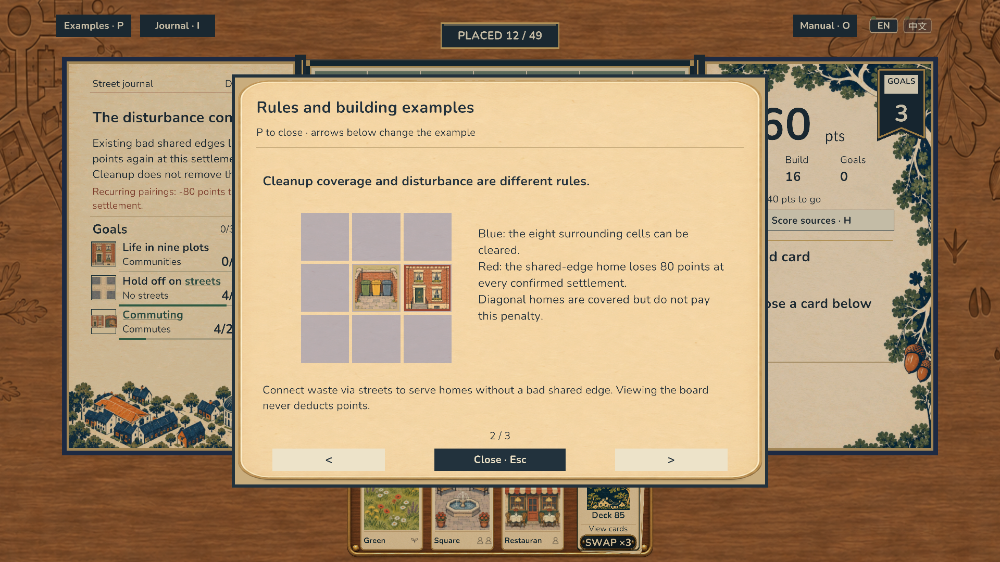
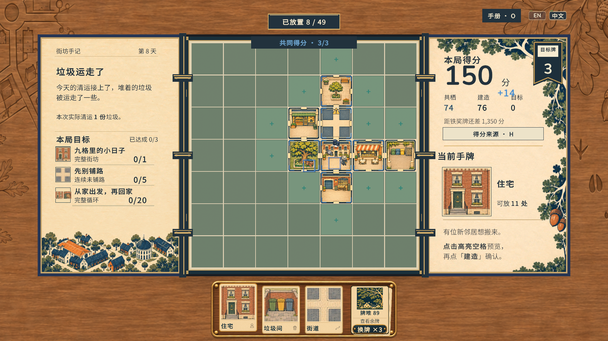
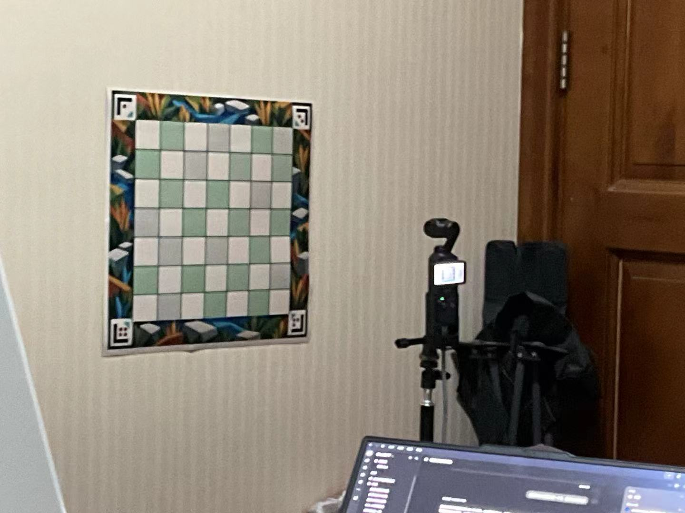

# Portfolio

SYMBIOSIS: 49 is a card-placement game about building a neighbourhood for people and urban wildlife.
The player changes the layout, then watches residents and animals use what has been built.
The project asks whether players can connect a visible outcome to a spatial rule and use it in their next decision.

*Approved Fill-interface fixture, 22 November. The left page groups goals and events, the centre holds the board, and the right page explains the score and current card. Later same-day commuting and journal features are shown below.*

**[Open the final Unity source](../Project/04-Final/README.md)** · [Download options](../Project/Downloads/README.md) · [Earlier versions](../Project/README.md)

| Part | What the player does |
| --- | --- |
| Fill | Build a finite 49-plot neighbourhood from a hand of cards |
| Endless | Continue construction on an expanding board |
| Desktop controls | Use mouse and keyboard; a camera is not required |
| Physical input experiment | Read printed room tokens through a camera; a separate technical prototype |

## A turn from card to consequence

*Opening fixture from the approved 22 November interface. The central oak comes before human services.*

1. Select a room card. Legal plots are marked on the board.
2. Preview a plot and confirm construction. The confirmation commits the placement.
3. Watch the run resolve resident and animal activity, upgrades and score changes.
4. Inspect the affected room, score source or journal before making another choice.

Eight fixed opening cards introduce the basic room relationships. The oak establishes an animal home before residents arrive.
Homes then create a need for work and meals. Free choice follows the opening, so the player can try a different arrangement
without first reading every rule at once.

## Buildings depend on their neighbours

*The third P-key reference page, from the final commuting/reference source.*

| Placement condition | Change shown in the game |
| --- | --- |
| Two linked green plots | A level-two habitat |
| Three or more linked green plots with two planting types | A level-three habitat |
| A home beside a connected pair of green plots | A garden-home variant |
| A restaurant beside a square | A terrace variant with three meal seats |
| Green on opposite sides of a street | A slow-street condition with lower traffic risk |

The upgraded images help distinguish a room's state. Habitat level is separate from maturity; new planting grows over time.
Feeding and completed routines earn their activity points when they occur. Traffic risk and street/green edge deductions are calculated separately.

## Residents need a complete route

*Home inspection in the final source. It shows destinations, coordinates and missing connections.*

Homes, workplaces, food services and streets form a route system. Residents receive work and meal destinations automatically,
within the available capacity and legal connections. Selecting a home shows its assigned destinations.
A route can fail because access is broken or a service has no capacity; adding another building is useful only if the layout
makes it reachable. The [commuting reference](media/screenshots/building-example-1-en.png) shows edge connections and a disconnected diagonal example.

## Wildlife food and housing disturbance

*The second P-key reference page distinguishes collection from a bad housing edge.*

Green spaces provide habitat and food conditions. Resident meals at a supermarket can leave temporary animal food.
Food being present is different from an animal reaching it and eating; animal points follow recorded feeding.

A waste room can collect from nearby plots and along connected streets. A home sharing an edge with it can still suffer
disturbance. Collection coverage and that penalty are separate rules. In Fill, an existing bad edge can deduct again at a
later confirmed settlement. This gives placement a continuing cost and makes the reason for each loss important to inspect.

## Follow each part of the score

| Residents | Animals | Shared activity |
| --- | --- | --- |
|  |  |  |
| Bronze, silver and gold cues identify resident contributions. | Green cues identify animal contributions. | Blue cues identify shared contributions. |

*Three-phase Unity fixtures from 22 November. Click a preview to inspect the full frame.*

Settlement proceeds through resident, animal and shared activity. Each batch highlights its contributors, then clears for the next. Floating values identify a source while it is happening. Deductions use their own colour and written cause.

## Explanations remain available

*The I-key journal in the final source, with the newest recorded events first.*

The journal records placements, upgrades, commutes, feeding and deductions, including the room pairs responsible for recurring losses.
It gives the player another way to inspect simultaneous events after floating labels disappear.
The [H-key score-source view](media/screenshots/score-index-en.png), shown in an earlier 21 November fixture,
reopens the latest settlement and highlights its relevant rooms and visible actors. Players can also close the result panel
to review their finished layout.

*Marked manual destination in the final source.*

Ten core terms provide short hover meanings and clickable manual destinations. Manual explanations link to other entries.
O opens the manual, P opens three pages of building examples, and I opens the independent journal.
These views let the player inspect the recorded run between placements.

## Cards and goals make the next choice visible

*Deck-catalogue fixture, 22 November. The counts come from the run's actual card supply.*

The catalogue shows cards in the pile, held cards and built rooms. Green variants share one supply. Three goals offer different directions for a run. Goal progress stays on the left page, while the
hand and deck sit below the board. This allows a player to compare what a goal asks for with the rooms still available.

## How the object changed

| Earlier room-board version | Later illustrated construction version |
| --- | --- |
|  |  |
| A populated board and fixed central green area; the player rearranged rooms. | A hand of illustrated cards; the player builds the layout one placement at a time. |

The project moved from feeding pigeons to park planning, an open city and modular rooms. Construction made it possible to
introduce a room when the player needed it. The visual work also moved from top-view room interiors toward recognisable
building fronts, illustrated habitats and a compact hand. The [visual development journal](DEVELOPMENT_JOURNAL.md#timeline)
shows each stage with dated or qualified source captions.

## Physical input prototype

*Project setup photograph retained in the supplied presentation. The capture date is unrecorded.*

A marked 7 by 7 board and 80 printed tokens explored a physical layout input. One recognised token could produce its
corresponding Unity plot. Other controls remained on screen. The setup explored physical placement alongside the desktop interface.

## Contribution and evidence

I defined the spatial rules and opening progression, directed the visual revisions, and used feedback to decide what to change.
[Authorship and tools](AI_AND_AUTHORSHIP.md) and [asset sources](ASSET_PROVENANCE.md) provide the contribution records.

The [evaluation](EVALUATION.md) explains how players interpreted the spatial rules and how their feedback informed revisions.
[Downloads](../Project/Downloads/README.md) lists the available source and executable versions.
