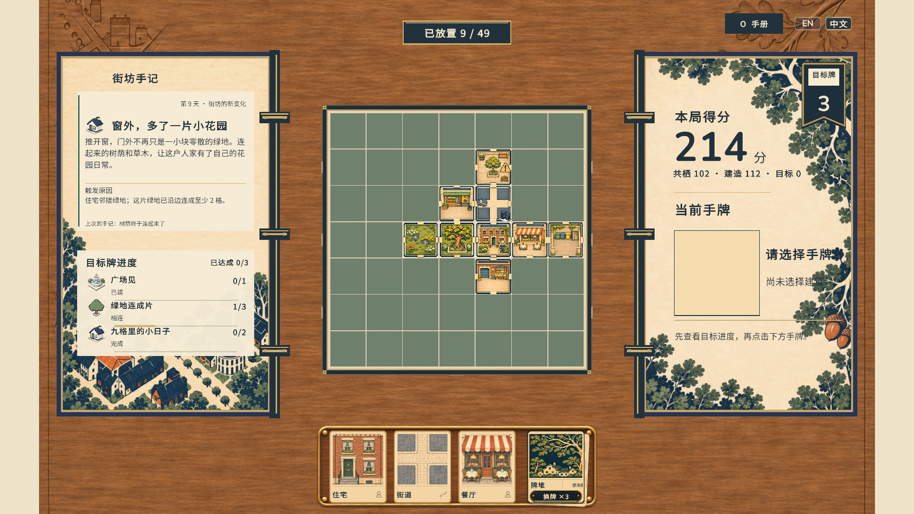
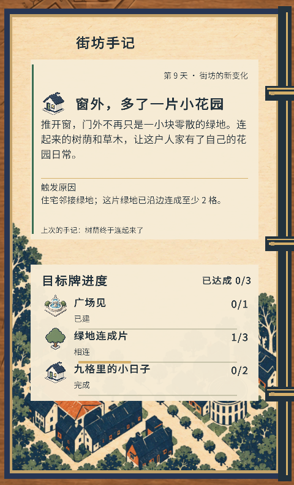

# Portfolio: outcomes and evidence

## Current artefact

*Figure 1. Current construction interface rendered in Unity from a nine-placement fixture. The room model, card hand,
score leaf, three-goal bookmark and neighbourhood journal are shown together. This controlled capture is not a participant session.*

*Figure 2. A garden-home story with its actual connected-green trigger. The three goal rows remain below it. The journal projects
model facts into narrative; it does not itself change a score or demonstrate that players understood the relationship.*

## Earlier direction

*Figure 3. An earlier browser prototype explored spatial feeding and shared conditions. It is evidence of the web stage only.
The associated code and timeline remain in the [web repository](https://github.com/Ketian-LI/urban-wildlife-simulation).*

## Supporting views

- [Architecture and entry points](TECHNICAL_GUIDE.md)
- [Editable models and conversion provenance](ASSET_PROVENANCE.md)
- [Development decisions and failures](DEVELOPMENT_JOURNAL.md)
- [Build/download status](RELEASE_NOTES.md)

A final demonstration video and any approved participant/physical-work images remain author-supplied items. No video is fabricated
or linked to an unrelated demonstration. The current brief does not prescribe a fixed five-image portfolio.
