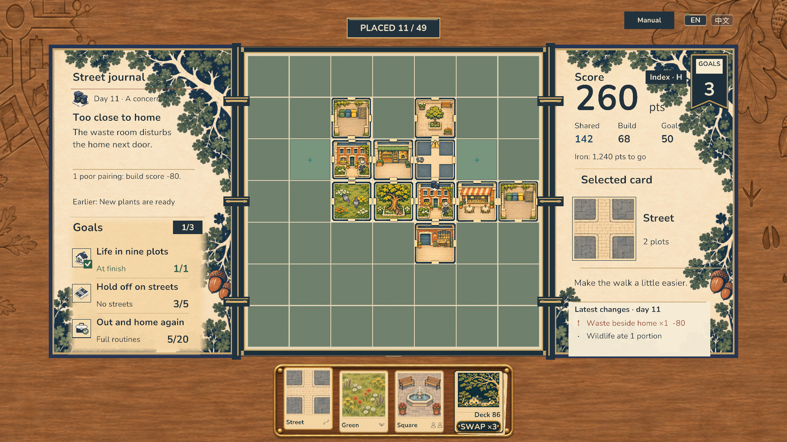
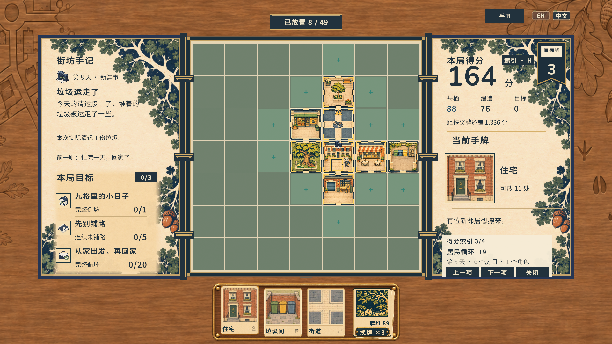

# Portfolio

SYMBIOSIS: 49 turns a sequence of small placements into a shared neighbourhood. The player builds homes, services and
habitat, then watches residents and animals use the space.

## The board and hand

The illustrated hand sits below the board. The left page holds stories and goals; the right page keeps scores and the
selected card together. Rooms change as their neighbours change.

## Reading a consequence

A waste facility next to a home produces a deduction. The interface keeps the cause visible after the animation ends.
The journal describes the event and the score panel shows the recent change.

## Finding the rooms behind a score

The score-source view returns to the last settled day's contributors. It highlights relevant plots and visible participants.
In Endless, it can centre a cause outside the current view.

These images are actual Unity renders of fixed test layouts, captured during the 21 November source revisions.
They are not participant sessions. The later city-background mockup is a design preview and has not replaced this source.
A demonstration of the final submitted build is [still to be added](media/demonstrations/README.md).

## Where it began

The browser prototype explored feeding and animal responses. Later versions introduced physical input, city networks and
room construction. The [development journal](DEVELOPMENT_JOURNAL.md) explains those changes.

Read the [project report](PROJECT_REPORT.md) for the design account, [evaluation](EVALUATION.md) for the evidence,
or [setup guide](technical/SETUP_AND_BUILD.md) to run the game.
