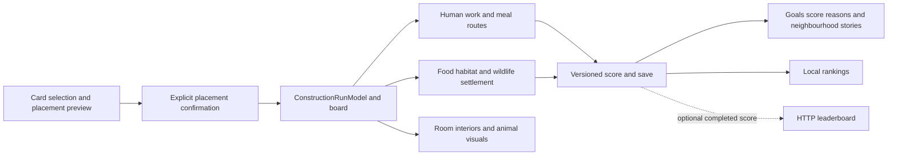

> Archived overview, replaced on 22 November 2026. It describes its recorded snapshot.

# Run, inspect and rebuild

## Supported snapshot

- Unity **6000.3.4f1**, recorded in [ProjectVersion.txt](../../../ProjectSettings/ProjectVersion.txt).
- URP and other dependencies are recorded in [manifest.json](../../../Packages/manifest.json) and its lockfile.
- Open **Assets/Scenes/Main.unity**. Main menu choices enter **ConstructionPrototype.unity**.
- English and Chinese are supported. The keyboard/mouse path is the reproducible baseline for the current construction game.

## Run a Windows download

Extract the whole release ZIP and run `SYMBIOSIS49-NoCamera.exe`. Keep the `_Data`, Mono and Unity runtime files beside it.
Older saves retain their saved score rules; start a new game to use V13. Do not delete a save merely because it uses older rules.

## Build from source

1. Clone/download this archive branch and add the project root to Unity Hub.
2. Open with 6000.3.4f1 and allow package and asset import to finish.
3. Verify the build scenes are `Main` and `ConstructionPrototype`.
4. Choose `Urban Wildlife > Build Windows No-Camera`, or call
   `UrbanWildlifeRooms.Editor.UrbanWildlifeBuildPipeline.BuildWindowsNoCamera` in batch mode.
5. The default output is `Builds/Windows-NoCamera/`. `SYMBIOSIS49_BUILD_OUTPUT_ROOT` can redirect the build.

The optional Windows camera recogniser is distributed here as Python source, not a frozen executable.
Its dependencies are in `Tools/CameraRecognition/requirements.txt`. Fill and Endless do not require a camera or Python.
The Windows build helper copies the available camera-tool source; packaging that optional recogniser is a separate step.

For macOS, open the same project in Unity on a Mac, select macOS in Build Profiles and choose the architecture for the target
computer (or Intel + Apple silicon for a Universal build). The editor menu also provides `Build macOS No-Camera`.
The local Windows machine lacked the matching Mac module and its official download returned 404 during preparation.
No `.app`, signing, notarisation or Mac runtime success is claimed. The Windows-only camera entry is hidden on macOS.

## Architecture and inspection points

| Area | Read first |
| --- | --- |
| Authoritative run/turn state | [ConstructionRunModel.cs](../../../Assets/Scripts/Core/ConstructionRunModel.cs) |
| Placement, adjacency and upgrades | [ConstructionPlacementScore.cs](../../../Assets/Scripts/Core/ConstructionPlacementScore.cs) |
| Food and residents | [ConstructionFoodModel.cs](../../../Assets/Scripts/Core/ConstructionFoodModel.cs), [ConstructionHumanModel.cs](../../../Assets/Scripts/Core/ConstructionHumanModel.cs) |
| Score history and compatibility | [ConstructionScoreLedger.cs](../../../Assets/Scripts/Core/ConstructionScoreLedger.cs) |
| Three goal cards | [ConstructionSpecialTaskModel.cs](../../../Assets/Scripts/Core/ConstructionSpecialTaskModel.cs) |
| Interface orchestration | [ConstructionPrototypeController.cs](../../../Assets/Scripts/Presentation/ConstructionPrototypeController.cs) and its partial files |
| Narrative derived from observations | [ConstructionNeighborhoodStories.cs](../../../Assets/Scripts/Presentation/ConstructionNeighborhoodStories.cs) |
| Build entry points | [UrbanWildlifeBuildPipeline.cs](../../../Assets/Scripts/Editor/UrbanWildlifeBuildPipeline.cs) |

## Contributor inspection

[ConstructionScoreTrace.cs](../../../Assets/Scripts/Presentation/ConstructionScoreTrace.cs) projects the last settled day into room and actor references.
The controller partial handles review and keyboard input; the world-view partial resolves existing actors.
See [controls](../../technical/CONTROLS.md) for player-facing behaviour and restrictions.

## Verification

Use Unity Test Runner for EditMode and PlayMode. The [evaluation index](../../EVALUATION.md) identifies the selected exported batches;
they do not represent a fresh pass of every test in the repository. The documentation validator can be run with
`python Tools/archive/verify_archive.py`. It checks local links, large files, required source roots and source-manifest hashes.
The source ZIP contains ordinary asset bytes rather than Git LFS pointer files. Library, Temp, Logs and user saves are excluded.
The archive's `.gitattributes` preserves file bytes so the SHA-256 manifest can be checked after download on another platform.
