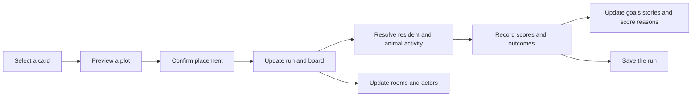

# Architecture

The run model owns the game state. The controller asks it to perform an action, then updates the interface and visible world.
Room graphics, stories and score labels describe that state; they do not decide whether an action earned points.

## One placement

Selecting a card changes the preview. It does not place a room.
The controller's `ConfirmPendingPlacement` commits a valid choice.
Resident routines and animal meals must be recorded before their activity scores are awarded.

## Code map

| Responsibility | Start here |
| --- | --- |
| Turn, cards, run state and export/restore | [ConstructionRunModel](../../Assets/Scripts/Core/ConstructionRunModel.cs) |
| Plots and placed rooms | [ConstructionBoardModel](../../Assets/Scripts/Data/ConstructionBoardModel.cs) |
| Placement effects and neighbour upgrades | [ConstructionPlacementScore](../../Assets/Scripts/Core/ConstructionPlacementScore.cs) |
| Green connections and habitat | [ConstructionGreenPatchModel](../../Assets/Scripts/Core/ConstructionGreenPatchModel.cs) |
| Food supply and settlement | [ConstructionFoodModel](../../Assets/Scripts/Core/ConstructionFoodModel.cs) |
| Resident work and meal routines | [ConstructionHumanModel](../../Assets/Scripts/Core/ConstructionHumanModel.cs) |
| Score history and rule versions | [ConstructionScoreLedger](../../Assets/Scripts/Core/ConstructionScoreLedger.cs) |
| Goal conditions and rewards | [ConstructionSpecialTaskModel](../../Assets/Scripts/Core/ConstructionSpecialTaskModel.cs) |
| Interface and action flow | [ConstructionPrototypeController](../../Assets/Scripts/Presentation/ConstructionPrototypeController.cs) |
| Rooms and visible actors | [ConstructionWorldView](../../Assets/Scripts/Presentation/ConstructionWorldView.cs) |
| Run storage | [ConstructionRunStore](../../Assets/Scripts/Core/ConstructionRunStore.cs) |

## Interface responsibilities

The large controller is split into partial files. Use the relevant part rather than putting every change in the main file.

| Change | Relevant part |
| --- | --- |
| Hand, deck and swap display | [FillHand](../../Assets/Scripts/Presentation/ConstructionPrototypeController.FillHand.cs) |
| Three-goal selection and progress | [SpecialTasks](../../Assets/Scripts/Presentation/ConstructionPrototypeController.SpecialTasks.cs) |
| Journal layout | [NeighborhoodStories](../../Assets/Scripts/Presentation/ConstructionPrototypeController.NeighborhoodStories.cs) |
| Text derived from recorded events | [ConstructionNeighborhoodStories](../../Assets/Scripts/Presentation/ConstructionNeighborhoodStories.cs) |
| Score-source controls | [ScoreTrace controller](../../Assets/Scripts/Presentation/ConstructionPrototypeController.ScoreTrace.cs) |
| Finding visible contributing actors | [ScoreTrace world view](../../Assets/Scripts/Presentation/ConstructionWorldView.ScoreTrace.cs) |
| Local results | [LocalLeaderboard](../../Assets/Scripts/Presentation/ConstructionPrototypeController.LocalLeaderboard.cs) |
| Optional online results | [NetworkLeaderboard](../../Assets/Scripts/Presentation/ConstructionPrototypeController.NetworkLeaderboard.cs) |

## Boundaries to preserve

A route preview is a forecast. A saved meal or routine is an observed outcome in the model.
The score-source view reads the last settlement without awarding its points again.
Stories also read recorded facts; they do not create resources.

The shared opening board belongs to the menu/scene transition.
Its sequence is described in [scenes and modes](SCENES_AND_MODES.md).
Current saves are separate from the earlier full-board session format.

For verification, choose checks that exercise the changed behaviour.
The [evidence index](../evidence/README.md) identifies the saved reports and their limits.
