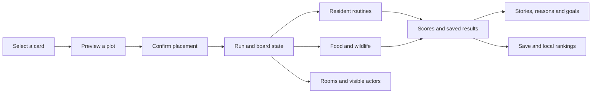

# Architecture

The run model owns game state. Presentation code reads it to draw the board and interface.
A preview does not commit a room. Recorded activity, rather than a possible route, supplies meal and routine scores.

| System | Start with |
| --- | --- |
| Turn, cards and saved run | [ConstructionRunModel](../../Assets/Scripts/Core/ConstructionRunModel.cs) |
| Board and plots | [ConstructionBoardModel](../../Assets/Scripts/Data/ConstructionBoardModel.cs) |
| Placement and neighbour upgrades | [ConstructionPlacementScore](../../Assets/Scripts/Core/ConstructionPlacementScore.cs) |
| Food | [ConstructionFoodModel](../../Assets/Scripts/Core/ConstructionFoodModel.cs) |
| Resident activity | [ConstructionHumanModel](../../Assets/Scripts/Core/ConstructionHumanModel.cs) |
| Score history | [ConstructionScoreLedger](../../Assets/Scripts/Core/ConstructionScoreLedger.cs) |
| Three goals | [ConstructionSpecialTaskModel](../../Assets/Scripts/Core/ConstructionSpecialTaskModel.cs) |
| Interface | [ConstructionPrototypeController](../../Assets/Scripts/Presentation/ConstructionPrototypeController.cs) and its partial files |
| Stories | [ConstructionNeighborhoodStories](../../Assets/Scripts/Presentation/ConstructionNeighborhoodStories.cs) |
| Score-source review | [ConstructionScoreTrace](../../Assets/Scripts/Presentation/ConstructionScoreTrace.cs) |
| Saving | [ConstructionRunStore](../../Assets/Scripts/Core/ConstructionRunStore.cs) |

The score-source view reads the last settled day. It finds known rooms and visible actors without changing the saved result.
The optional HTTP leaderboard is separate from ordinary saving and local rankings.
See [save format](SAVE_FORMAT.md), [controls](CONTROLS.md) and the [service guide](../../Services/leaderboard/README.md).
