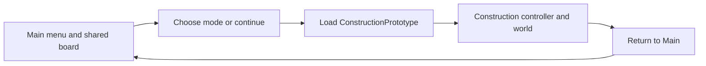

# Scenes and modes

The build contains two enabled scenes: `Main` and `ConstructionPrototype`.
[EditorBuildSettings](../../Project/04-Final/ProjectSettings/EditorBuildSettings.asset) records them.

## Opening and return

Main provides the menu and the shared opening board.
[ConstructionMenuEntry](../../Project/04-Final/Assets/Scripts/Presentation/ConstructionMenuEntry.cs) records the selected mode and enters ConstructionPrototype.
The normal shared-board transition loads the construction scene additively and then makes it active.
The source also contains a single-scene fallback.

Keeping the opening board during loading helps the menu and playable scene share the same tabletop.
The controller's paper interface takes over after the entrance motion.
The transition code also handles the route back to Main.

This describes the source flow. The [evaluation](../../Documentation/EVALUATION.md) records the retained opening-check failures and their scope.

## Mode differences

| Mode | Main distinction | Documentation caution |
| --- | --- | --- |
| Fill | A finite 49-plot construction run; current hand rules use a 100-card supply | Card counts, trophies and tutorial descriptions must match the saved rule version |
| Endless | A board that can expand beyond the current view | Do not describe the Fill supply or its completion trophy as a universal Endless rule |
| BoardGame | Separate physical board-game inventory and rules | Its 80-tile inventory is not the digital Fill deck |
| Earlier Research and rearrangement systems | Retained historical code and experiments | Their settings and test results do not describe the current construction study automatically |

The current construction menu routes Fill, Endless and BoardGame into the construction scene.
Earlier Research systems are part of the [project history](../process/REPOSITORY_LINEAGE.md).
The current desktop construction path needs no camera.
Camera tools remain a separate experimental input path.

Use [game rules](GAME_RULES.md) for current player-facing rules and [save format](SAVE_FORMAT.md) for version handling.
