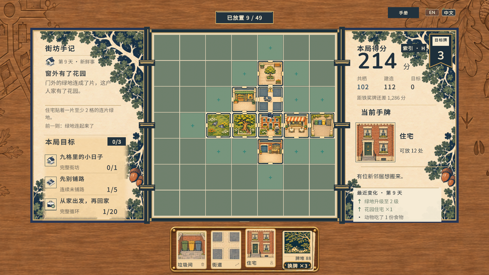

# SYMBIOSIS: 49

A card-placement game about building a neighbourhood for people and urban wildlife.

Place homes, shops, workplaces and green spaces on a tabletop board. Residents need routes to work and meals.
Animals need food they can reach. Each placement changes what can happen next.

Read the [project overview and linked timeline](Documentation/PROJECT_OVERVIEW.md) for the folder map,
file types and the route from the first prototype to the current source.

*Unity render of a fixed test layout. The game supports English and Chinese.*

## Play or open the project

- [Download the Windows game](https://github.com/Ketian-LI/symbiosis-49-unity/releases/tag/archive-2026-11-20).
  This is the **19 November build**. Later source changes are listed in the [release notes](Misc/process/RELEASE_NOTES.md).
- Open this repository in **Unity 6000.3.4f1**, load `Assets/Scenes/Main.unity`, then press Play.
- See [setup and build instructions](Misc/technical/SETUP_AND_BUILD.md) for the complete steps.

Fill and Endless use a mouse and keyboard. A camera is not required.
The macOS download is a Unity source project; it does not contain a built Mac app.

## What the project explores

The project explores how players learn rules through placement and feedback. It looks at whether they can connect a layout
choice to what residents and animals do, and whether they want to try another arrangement.

The game grew from a browser feeding prototype into a room-based construction game. Its species, food values and scores
are designed game rules. They are not predictions of a real ecosystem.

## Read the project

The [documentation guide](Documentation/README.md) maps all sections.
The [delivery record](Documentation/PROJECT_STATUS.md) identifies source and download versions.

| Start here | What it covers |
| --- | --- |
| [Portfolio](Documentation/PORTFOLIO.md) | The game and selected screenshots |
| [Project report](Documentation/PROJECT_REPORT.md) | The problem, design choices and implementation |
| [Development journal](Documentation/DEVELOPMENT_JOURNAL.md) | How the project changed and why |
| [Evaluation](Documentation/EVALUATION.md) | User feedback, technical checks and open questions |
| [Thesis](Thesis/README.md) | Dissertation record |
| [Ethics and limitations](Documentation/ETHICS_AND_LIMITATIONS.md) | Representation, participant data and practical limits |
| [Ethics reflection](Documentation/ETHICS_REFLECTION.md) | Research conduct, risks and lessons |
| [AI use and authorship](Documentation/AI_AND_AUTHORSHIP.md) | Tools and project contributions |
| [Asset sources](Documentation/ASSET_PROVENANCE.md) | Artwork, models, fonts and licences |
| [Assessment map](Documentation/assessment/REQUIREMENTS.md) | Where to find each required item |

## Version and evidence record

The source includes the 21 November interface revisions. The Windows download is the earlier 19 November build.
The [delivery record](Documentation/PROJECT_STATUS.md) and [submission inventory](Documentation/assessment/SUBMISSION_CHECKLIST.md)
identify the included material. The thesis PDF and detailed anonymous study evidence are not included.
The [ethics reflection](Documentation/ETHICS_REFLECTION.md) records the study's review and data-handling position.

Detailed technical guides, revision notes, saved software reports and older designs are grouped in [Misc](Misc/README.md).
