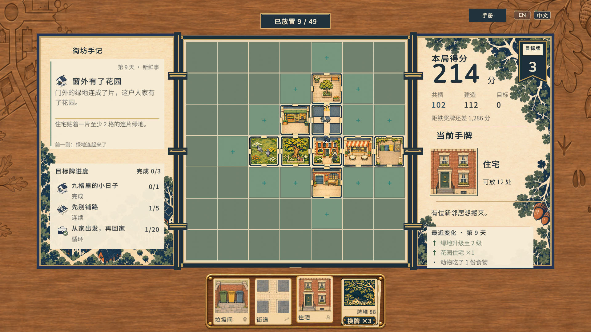

# SYMBIOSIS: 49

**A Unity game about arranging shared urban space for human and wild neighbours.**

This is the current source update, revised on **21 November 2026**, following the English assessment archive of 20 November for
**MSc Creative Computing Final Project, IU000293**. It brings the current construction game,
its source assets, selected verification records and the project's earlier repositories into one navigable account.
It is an archive of work, **not a claim that all assessment materials have been completed or submitted**.

*Current Unity interface, captured from a deterministic nine-placement test fixture. The in-game language shown is Chinese;
the game supports English and Chinese. This is an actual Unity render, not participant evidence or a generated gameplay mockup.*

New Fill runs use trophy bands 1500 / 2500 / 3500 / 4500. Historical runs retain their own bands.
The latest source also includes larger reading text and a pigeon-save restoration fix.
See [the update record](Docs/TROPHY_AND_UI_READING_2026-11-20.md).
The [21 November skill-guided revision](Docs/SKILL_GUIDED_UI_2026-11-21.md) groups score information, retains observed
upgrade/deduction reasons, checks both languages and extends calibration to 72 diagnostic runs. Gameplay points remain V13.
Downloadable executables on the 20 November archive release remain earlier builds; this branch updates source.

## Start here

| Reader's question | Where to go |
| --- | --- |
| What is the current work? | [Project report](Documentation/PROJECT_REPORT.md) and [portfolio](Documentation/PORTFOLIO.md) |
| How do I run or rebuild it? | [Technical guide](Documentation/TECHNICAL_GUIDE.md) |
| How did it develop? | [Development journal](Documentation/DEVELOPMENT_JOURNAL.md) and [repository lineage](Documentation/REPOSITORY_LINEAGE.md) |
| Which claims have evidence? | [Evaluation](Documentation/EVALUATION.md) and [test records](Documentation/evidence/report-index.json) |
| How does it meet the brief? | [Assessment map](Documentation/ASSESSMENT_MAP.md) and [remaining items](Documentation/FINAL_CHECKLIST.md) |
| What about ethics, authorship and assets? | [Ethics](Documentation/ETHICS_AND_LIMITATIONS.md), [AI disclosure](Documentation/AI_AND_AUTHORSHIP.md), [provenance](Documentation/ASSET_PROVENANCE.md) |
| Where is the thesis? | [Thesis status](Thesis/README.md): final PDF intentionally pending author confirmation |
| What can I download? | [Archive release](https://github.com/Ketian-LI/symbiosis-49-unity/releases/tag/archive-2026-11-20) and [release notes](Documentation/RELEASE_NOTES.md) |

## The current interaction

Players place room cards rather than commanding animals directly. Homes, work, meals, green habitat, streets and waste
facilities influence what can happen. The model settles actual food use and resident routines; previews are distinguished
from observed results. Fill uses a 49-cell board and a finite digital card supply. Endless expands beyond the viewing window.
Neighbouring rooms can upgrade, and the journal explains selected observed changes through short stories and explicit causes.

**Research question:** How can an interactive simulation make the ways in which human spatial decisions shape urban wildlife
conditions perceptible? The current game investigates this through adjacency, shared resources and consequence feedback.
These are speculative design rules, not a predictive ecological or traffic model.

## Version boundaries

The [web prototype](https://github.com/Ketian-LI/urban-wildlife-simulation) explored feeding and delayed effects.
The [tangible Unity experiment](https://github.com/Ketian-LI/urban-wildlife-tangible-unity) explored token input and city networks.
The current source here is the later **SYMBIOSIS: 49 construction branch**, including V13 scoring and the neighbourhood journal.
Earlier room-rearrangement/Research systems remain in the source and historical documents; their features and evaluation
must not be attributed automatically to the current game. See the [lineage map](Documentation/REPOSITORY_LINEAGE.md).

Windows was built and startup-checked locally. The macOS deliverable is a source project, **not a built or Mac-tested app**.
The optional physical-camera path is an experimental branch of the project, not the condition evaluated by the reported remote study.

## Archive status

Source, process documentation and selected technical evidence are included. A working thesis reports five remote Fill completions
and three questionnaire responses, but the exact distributed build and raw evidence have not been verified in this archive.
The author asked to leave the final thesis and approved anonymous research materials pending. No participant identities,
private chats or consent records are published here. Automated checks are not user-study findings.

Development was substantially AI-assisted; [the disclosure](Documentation/AI_AND_AUTHORSHIP.md) describes that assistance and
the remaining provenance gaps. Historical Chinese documents and source comments are retained as records; the archive's navigation,
report, research account and instructions are in English.
