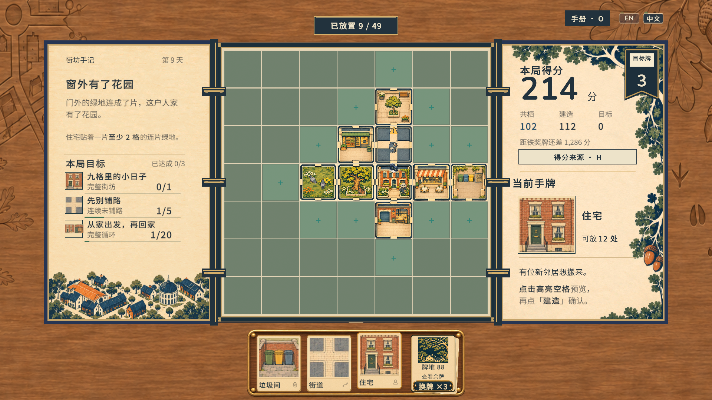

# SYMBIOSIS: 49

A Unity card-placement game about the space shared by residents and urban wildlife.

Place homes, services and green habitat on a tabletop board. The simulation records food actually eaten and resident
routines actually completed. Stories, score reasons and participant highlights connect those outcomes to the layout.

The image is an actual Unity render of a fixed Fill test layout. English and Chinese are supported.
See the [approved interface revision](Docs/APPROVED_FILL_UI_2026-11-22.md) for remaining cards, pinned relationships and verification.

## Run the source

1. Download this branch or clone the repository.
2. Open the project root in Unity 6000.3.4f1.
3. Open `Assets/Scenes/Main.unity` and enter Play mode.
4. Choose Fill or Endless from the main menu.

The [technical guide](Documentation/TECHNICAL_GUIDE.md) covers dependencies, architecture and rebuilding.
Fill and Endless use keyboard/mouse input and do not require a camera.

## Explore the project

| Document | Purpose |
| --- | --- |
| [Project report](Documentation/PROJECT_REPORT.md) | Enquiry, interaction decisions and implementation boundaries |
| [Development journal](Documentation/DEVELOPMENT_JOURNAL.md) | Decisions, faults, revisions and their evidence across the project |
| [Repository lineage](Documentation/REPOSITORY_LINEAGE.md) | Links between the web, tangible Unity and construction versions |
| [Controls and score index](Documentation/CONTROLS.md) | Player actions, shortcuts and the meaning of highlights |
| [Evaluation](Documentation/EVALUATION.md) | Technical evidence, reported study history and limits on findings |
| [Assessment map](Documentation/ASSESSMENT_MAP.md) | Navigation against the MSc Creative Computing brief, IU000293 |
| [Portfolio](Documentation/PORTFOLIO.md) | A shorter account of the design work |
| [AI disclosure](Documentation/AI_AND_AUTHORSHIP.md) and [asset provenance](Documentation/ASSET_PROVENANCE.md) | Assistance, external assets and unresolved attribution |

## Research question

How can an interactive simulation make the ways in which human spatial decisions shape urban wildlife conditions perceptible?
The construction game explores this through adjacency, shared food and consequence feedback. Its species, scores and risks are
authored game rules. The [project report](Documentation/PROJECT_REPORT.md) explains the enquiry and its limitations.

## Delivery and research status

This branch contains the Unity source and English process documentation. The current interface revisions have no new executable build.
The [20 November archive release](https://github.com/Ketian-LI/symbiosis-49-unity/releases/tag/archive-2026-11-20) retains its earlier
Windows build and macOS source delivery. See [release notes](Documentation/RELEASE_NOTES.md) before choosing a download.

The [evaluation record](Documentation/EVALUATION.md) distinguishes automated checks from author-reported playtesting.
The final [thesis PDF](Thesis/README.md) and approved anonymous research materials remain pending author confirmation.
The archive does not publish participant identities, private conversations or consent records.

Earlier rearrangement/Research and physical-camera systems remain as historical source. Their evaluation cannot be attributed
automatically to this construction revision. Open [remaining assessment items](Documentation/FINAL_CHECKLIST.md) for outstanding work.
